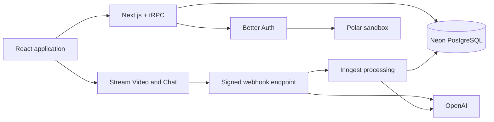

# Meet AI

**AI-assisted video meetings, from the first conversation to the follow-up.**

A full-stack Next.js application for creating custom AI meeting agents, joining live video calls, and revisiting conversations through recordings, searchable transcripts, generated summaries, and contextual chat.

[Explore the source](https://github.com/guptaanushika37/next15-meet-ai-main) · [Setup](#getting-started) · [Deployment](#deploying-to-vercel) · [Architecture](#architecture)

> This repository is based on [CodeWithAntonio’s Meet AI project](https://github.com/code-with-antonio/next15-meet-ai). Original implementation credit belongs to CodeWithAntonio. This edition preserves the source and adds clearer setup, deployment documentation, and repository maintenance improvements. It does not claim the tutorial implementation as original work.

## Live interactive prototype

[**Open the Meet AI prototype**](https://next15-meet-ai-main.vercel.app)

The deployed version is a standalone, responsive demo in `prototype/`. Explore sample meetings, search and filter the workspace, create meetings and agent profiles, try a simulated call, read illustrative summaries and transcripts, download sample notes, and ask scripted follow-up questions. Changes are saved in your browser only. Calls and AI responses are simulated; no service credentials are required.

The original full-stack Next.js application remains in this repository for future development. Its integration setup is documented below.

### Run the prototype locally

```sh
python -m http.server 4173 --directory prototype
```

Open `http://localhost:4173`. To deploy this version on Vercel, use **Other** as the framework, `prototype` as the root directory, no build/install command, and `.` as the output directory. `prototype/vercel.json` supplies the static route fallback.

## What the application does

- **Custom agents:** create and manage AI agents with meeting-specific instructions.
- **Live conversations:** Stream Video provides the call interface and connects an OpenAI realtime agent.
- **Meeting lifecycle:** upcoming, active, processing, completed, and cancelled meeting states.
- **Post-call review:** recording playback, transcript search, and AI-generated meeting summaries.
- **Contextual chat:** ask follow-up questions using the meeting summary as context.
- **Accounts and subscriptions:** Better Auth authentication with email/password and optional GitHub/Google OAuth; Polar-backed subscriptions and usage limits.
- **Background processing:** Inngest retrieves and processes meeting transcripts outside the browser request.

These capabilities require the corresponding services to be configured. A successful web deployment alone does not verify a real call, payment, or summary workflow.

## Stack

| Layer | Technologies |
| --- | --- |
| Application | Next.js 15, React 19, TypeScript |
| UI | Tailwind CSS 4, shadcn/ui, Radix UI, Lucide |
| API and state | tRPC 11, TanStack Query, Zod |
| Data | Neon PostgreSQL, Drizzle ORM |
| Identity | Better Auth |
| Calling and messaging | Stream Video, Stream Chat |
| AI | OpenAI realtime integration and chat completions |
| Background jobs | Inngest |
| Billing | Polar (sandbox in the supplied implementation) |

## Architecture



```text
src/
  app/                 Routes, layouts, and API endpoints
  components/          Shared components and UI primitives
  db/                  Drizzle schema and database connection
  inngest/             Background meeting processing
  lib/                 Auth, service clients, and utilities
  modules/             Agents, meetings, calls, dashboard, billing
  trpc/                Typed router, context, and query setup
public/                Illustrations and brand assets
```

## Getting started

### 1. Install

Use Node.js 22 LTS and npm. React 19 peer compatibility is configured in `.npmrc`.

```bash
git clone https://github.com/guptaanushika37/next15-meet-ai-main.git
cd next15-meet-ai-main
npm ci
```

### 2. Configure the services

Copy `.env.example` to `.env.local` and supply your own values. Never commit real credentials.

| Variables | Purpose |
| --- | --- |
| `DATABASE_URL` | Neon PostgreSQL connection string |
| `BETTER_AUTH_SECRET` | Strong, unique authentication signing secret |
| `BETTER_AUTH_URL`, `NEXT_PUBLIC_APP_URL` | Local URL or deployed HTTPS origin |
| `GITHUB_CLIENT_ID`, `GITHUB_CLIENT_SECRET` | GitHub OAuth application |
| `GOOGLE_CLIENT_ID`, `GOOGLE_CLIENT_SECRET` | Google OAuth application |
| `NEXT_PUBLIC_STREAM_VIDEO_API_KEY`, `STREAM_VIDEO_SECRET_KEY` | Stream Video project credentials |
| `NEXT_PUBLIC_STREAM_CHAT_API_KEY`, `STREAM_CHAT_SECRET_KEY` | Stream Chat project credentials |
| `OPENAI_API_KEY` | OpenAI access for realtime calls and summaries |
| `POLAR_ACCESS_TOKEN` | Polar sandbox access for the current billing implementation |
| `INNGEST_EVENT_KEY`, `INNGEST_SIGNING_KEY` | Production event delivery and signature verification |

Only `NEXT_PUBLIC_*` variables are intended for the browser. Keep all other keys on the server. OAuth callback URLs are `/api/auth/callback/github` and `/api/auth/callback/google` on the configured origin.

### 3. Initialize the database

```bash
npm run db:push
```

Run schema changes only against a database you control and have backed up. The source uses schema push; it does not include a reviewed production migration history.

### 4. Start development

```bash
npm run dev
```

For background processing, run the Inngest development server in another terminal:

```bash
npx inngest-cli@latest dev
```

For Stream webhooks, expose port 3000 through an HTTPS tunnel and configure your Stream dashboard to send supported call/chat events to `/api/webhook`. The original `dev:webhook` command contains an ngrok domain placeholder; replace it with your own static domain before running it.

## Commands

| Command | Purpose |
| --- | --- |
| `npm run dev` | Local Next.js server |
| `npm run build` | Production build and framework checks |
| `npm start` | Serve the production build |
| `npm run lint` | ESLint checks |
| `npm run typecheck` | TypeScript checks without emitting files |
| `npm run db:push` | Apply the Drizzle schema to the configured database |
| `npm run db:studio` | Inspect the database through Drizzle Studio |

## Deploying to Vercel

1. Import this repository into your Vercel account and select the **Next.js** framework preset. The repository root is the application root.
2. Use Node.js 22, `npm ci` for installation, and `npm run build` for the build command. Leave the output directory at the Next.js default.
3. Add the variables in `.env.example` to the intended deployment environment. Set both application URL variables to the deployment’s stable HTTPS origin.
4. Initialize a dedicated Neon database before testing authentication.
5. Register the deployed OAuth callback URLs with GitHub and Google.
6. Point Stream webhooks to `https://YOUR_DOMAIN/api/webhook`. Configure recording, transcription, and the relevant call/chat webhook events in Stream.
7. Connect the deployed `/api/inngest` endpoint to Inngest and set the production event/signing keys.
8. Configure Polar sandbox products and customer flows. The supplied client targets sandbox, not production payments.
9. Verify sign-in, agent creation, meeting creation, a real call, transcript delivery, summary processing, recording playback, and follow-up chat.

**Runtime caveat:** the Stream realtime-agent connection starts inside the webhook request. Validate its connection lifetime against your hosting plan and Stream’s current deployment guidance before relying on long meetings; a persistent worker/service may be necessary. Do not assume a successful Next.js build verifies that lifecycle.

## Deployment and verification status

The repository documents implemented source capabilities. Real-service workflows require valid configuration and end-to-end verification in the target environment. No generated metrics, testimonials, or production usage claims are included.

## Attribution and licensing

Original project: [code-with-antonio/next15-meet-ai](https://github.com/code-with-antonio/next15-meet-ai), by [CodeWithAntonio](https://codewithantonio.com).

The supplied source did not contain a standalone license file. This repository does not invent a license or change the original author’s rights. Review upstream permissions before redistribution or commercial use.
